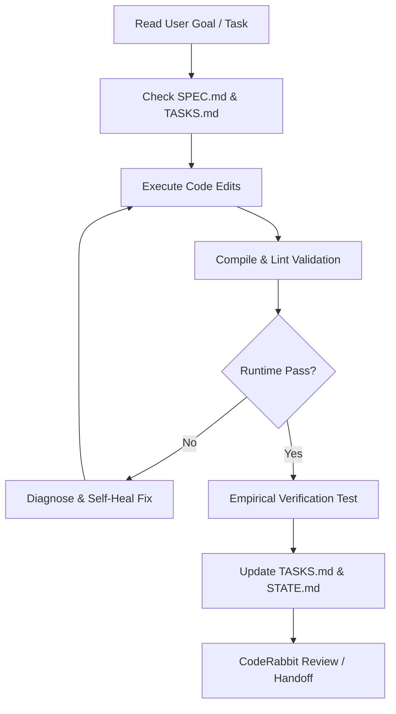

# RALPH_LOOP.md — Autonomous Verification & Execution Loop

> Continuous loop configuration for iterative task completion, empirical verification, and self-healing development.

---

## 🔄 Loop Definition

---

## 🛠️ Active Verification Checklist
1. **Dev Server Health**: Port 3000 must return HTTP 200 with zero unhandled exceptions.
2. **Ollama GPU Latency**: Queries to `/api/query` must complete or fall back smoothly without breaking UI state.
3. **CAN Stream Continuity**: Telemetry endpoint must poll and stream frame frames 0 to 999 sequentially.
4. **Scroll Independence**: Chat log must scroll up and down without moving the 3D car position or window scroll.
5. **UI Symmetry**: Both cockpit capsules must maintain equal 610px height on desktop viewports.

---

## 🚦 Current Loop Status
- **Current Iteration**: Loop #4 (UI & Scroll Isolation Verified)
- **Status**: 🟢 PASS
- **Next Planned Iteration**: Loop #5 (Mobile responsiveness audit)
